# 构图选择与空间细节

先确定读者要比较、追踪或理解的关系，再借用下面的安排。它们是已经试画过的选择，不是固定的整图模板；一张图可以组合两种关系。论文事实与失败细节留在各自案例中。

使用前先确定[图形主导与论文版面](visual-first-layout.md)。历史案例的海报尺寸、文字密度和大屏评分不证明它适合正文栏宽；借机制关系，重新按目标尺寸组织图形和短标签。

参考分开借用关系、组织和表面样式。画前用短brief决定主视觉、支撑区、普通流程和图内/图注分工；不要只收集机制限制。见 [机制提炼与构图](figure-planning.md)。

先想看具体画法，可打开[视觉入口图板](visual-entry.md)：用局部裁图比较形体、透明、读数、边界、文本和操作链；无匹配项时继续按下表选关系。

## 快速选择

对象不删、运算来源改变时，可先看[P2P两版](cases/p2p.md)：同一token的跨层地图定位局部旁路，校准与验证提供配置来源；不能把替换输出画成删除token。

| 阅读任务 | 主体怎么安排 | 实际图例 |
|---|---|---|
| 谁在接收数据，谁在当前阶段更新？ | 部署路径 + 参数更新协议 | [ProAda](cases/proada.md) · [RILA](cases/rila.md) · [RIBA](cases/riba.md) · [Carrier](cases/carrier.md) · [CamoShift](cases/camoshift.md) · [SmuDPatch](cases/smudpatch.md) · [AD-SRF](cases/ad-srf.md) |
| 哪些对象在访问、匹配或比较？ | 行列位置承担关系 | [WebMirage](cases/webmirage.md) · [IAU-FOA](cases/iau-foa.md) · [AdvPCS](cases/advpcs.md) · [CAGE](cases/cage.md) · [APC](cases/apc.md) · [FlashInfer](cases/flashinfer.md) · [UCD](cases/ucd.md) |
| 同一位置怎样对应多个表示或空间对象？ | 坐标对应 + 局部展开 | [SAWR](cases/sawr.md) · [MROP](cases/mrop.md) · [Tetris3D](cases/tetris3d.md) · [Carrier](cases/carrier.md) · [AR-AWM](cases/ar-awm.md) · [Response Profiles](cases/response-profile.md) · [CamoShift](cases/camoshift.md) · [NORP](cases/norp.md) · [CertMask](cases/certmask.md) · [ReMoE](cases/remoe.md) · [UAtt3D](cases/uatt3d.md) · [AdvTiles](cases/advtiles.md) |
| 几何量、作用范围或约束怎样决定变化？ | 几何对象 + 正视读出 | [GCD](cases/gcd.md) · [MABT](cases/mabt.md) · [Illusion of Depth](cases/illusion-depth.md) · [AdvFM](cases/advfm.md) · [PA-Attack](cases/pa-attack.md) · [SLASH](cases/slash.md) · [Topo-ADV](cases/topo-adv.md) · [LETHE](cases/lethe.md) · [Anti-I2V](cases/anti-i2v.md) |
| 参数或局部部件如何决定整体形状？ | 参数与部件生成具体对象 | [AdvFractal](cases/advfractal.md) · [SmuDPatch](cases/smudpatch.md) |
| 哪个值被选出，接着作用于哪些对象？ | 来源、选择与实际作用范围 | [Ancestor VLM](cases/ancestor-vla.md) · [APC](cases/apc.md) · [FeatureFool](cases/featurefool.md) · [Detect and Suppress](cases/detect-suppress.md) |
| 每一步究竟改了什么？ | 同一对象的连续状态 | [SRIM](cases/srim.md) · [SIGN](cases/sign.md) · [AntiStyler](cases/antistyler.md) · [D-Loop](cases/dloop.md) · [SmuDPatch](cases/smudpatch.md) · [PA-Attack](cases/pa-attack.md) · [PWaveP](cases/pwavep.md) · [DefenseSplat](cases/defensesplat.md) |
| 几个操作如何读写同一个系统？ | 共同状态成为主体 | [RaG-Tree](cases/ragtree.md) |
| 哪些维度保留，哪些被拼接或聚合？ | 索引轴与序列组织分开 | [View Swap](cases/view-swap.md) · [SAM-V](cases/samv.md) · [TARA](cases/tara.md) · [Anti-I2V](cases/anti-i2v.md) · [AD²](cases/ad2.md) · [M2Patch](cases/m2patch.md) |
| 答案、提示或代码改变了哪里？ | 文本本身作为视觉对象 | [GoA](cases/goa.md) · [MEMO](cases/memo.md) |

### 容易混淆的入口

- **共享状态 / 共享值分配：** 多个操作读写同一个索引或容器，选“看共享”；一个值复制到多个受体，选“看分配”。不能只凭“shared”一词选参考。

- **空间对应 / 几何约束：** 查同一位置在不同表示中的身份，选“追空间”；读位移、范数或几何量与统计读出的关系，选“读约束”。一张图可组合两者。

- **构造 / 状态：** 参数或部件生成整体形状，选“看构造”；已有对象经过步骤改变，选“读变化”。递归层和优化次数分别说明。

## 已有图稿：按问题借用

先选当前最影响理解的问题，再查看具体变体。下面是有条件的借用方向，不是风格排名，也不要求同时采用所有参考。

| 当前问题 | 可借用的具体变体 | 选择条件与代价 |
|---|---|---|
| 主体粗糙或太小 | [featurefool-r4](cases/featurefool.md) | 场景轮廓太粗：重绘形状并提高采样，让前后图仍来自同一输入。 几何和分辨率也改变；不是同内容排版对照。 |
| 主体粗糙或太小 | [lethe-r6](cases/lethe.md) | 数值与几何太小：压缩上下文，把空间交还主要比较。 普通流程和人物同时变小，完整机制仍需保留。 |
| 主体粗糙或太小 | [tara-r4](cases/tara.md) | 已有细节看不清：从相同观察直接裁切局部，保留总览索引与可见支持。 局部不换相机、不补被遮挡的内容；本例总览略缩、画布变窄变高。 |
| 三维像装饰 | [pa-attack-r7](cases/pa-attack.md) | 投影关系难辨：数据不变，改变展示相机以分开关键方向。 屏幕角度不是余弦；新增低维例不是模型特征降维。 |
| 三维像装饰 | [uatt3d-r2](cases/uatt3d.md) | 真实空间相交：三正交起点平面围绕物体，一条射线定位实际交点。 用于空间取样关系，不能借来表示任意网络层。 |
| 三维像装饰 | [slash-r2](cases/slash.md) | 装配与传播：透明前盖、镜头和传感器承担光学顺序，正视图展开几何约束。 直觉光路不等于光线追踪；别在任意深度网络中照搬物理光学。 |
| 只看到模块名 | [flashinfer-style-a2](cases/flashinfer.md) | 访问与映射：页ID、请求行和真实读取范围承担解释。 页索引变化不等于搬动数据，密集读数宜正视。 |
| 只看到模块名 | [pa-attack-r4](cases/pa-attack.md) | 加权与阶段：同一token连接权重、目标项和更新阶段。 权重作用于损失项，不得画成直接乘像素。 |
| 只看到模块名 | [goa-r6](cases/goa.md) | 文本操作：把实际证据、回答和修改位置展开。 文字相关性标签不自动变成数值加权和。 |
| 说明多或连线长 | [detect-suppress-r4](cases/detect-suppress.md) | 主干与局部重复：让特征对象本身成为干预节点。 主干仍可能转弯；控制信号和数据边需可分辨。 |
| 说明多或连线长 | [ragtree-r8](cases/ragtree.md) | 完整系统太散：围绕共享状态收拢准备、查询与维护。 长说明随图注；不能只留下查询而声称完整系统。 |
| 说明多或连线长 | [norp-r6](cases/norp.md) | 重复说明抢面积：改为可对照的状态列，UV紧邻曲面，主体保持大小。 材料/训练区别留图内，长设置随图注；新增p视图，非完全固定图内信息。 |

## 图例与取舍

以下是原创示意，包含同内容换画法、改变展开细节、改变方法参数三类试验，不能统称同内容对照。先看当前变体保留和省略了什么；比较依据见 [机制提炼与构图](figure-planning.md#比较时保留什么)。具体论文机制留在案例中。

### 完整方法：架构与训练协议分开组织

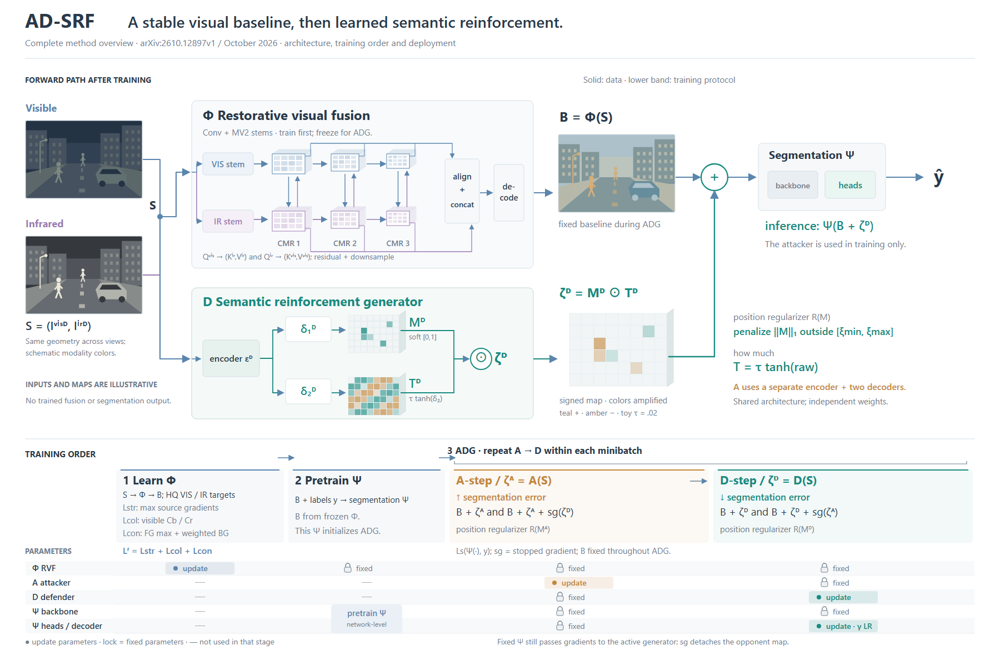

**安排：** 架构保留主要数据路径；训练可用阶段卡片，或将阶段与参数组对齐成表，目标紧邻对应列。

**取舍：** 减少重复网络，但需要按名称对应架构；状态表增加图例，小字仍需放大。冻结参数不等于截断输入梯度。

**各例依据：** [ProAda](cases/proada.md) · [RILA](cases/rila.md) · [RIBA](cases/riba.md) · [Carrier](cases/carrier.md) · [CamoShift](cases/camoshift.md) · [SmuDPatch](cases/smudpatch.md) · [AD-SRF](cases/ad-srf.md)。

### 正视对齐：位置承担对应

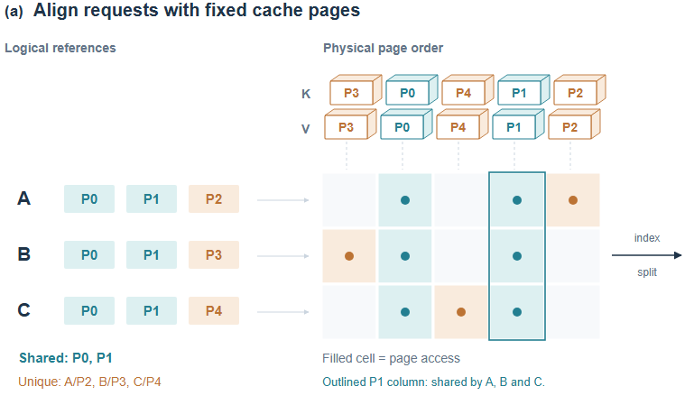

**安排：** 把实际对象放到行头和列头，比较结果放在交叉格；选择或归约紧邻矩阵。

**取舍：** 查找直接，但空间感较弱。多对一和中间映射仍需按真实规则表达。

**各例依据：** [WebMirage](cases/webmirage.md) · [IAU-FOA](cases/iau-foa.md) · [AdvPCS](cases/advpcs.md) · [CAGE](cases/cage.md) · [APC](cases/apc.md) · [FlashInfer](cases/flashinfer.md) · [UCD](cases/ucd.md)。

### 共同坐标上的分层展开

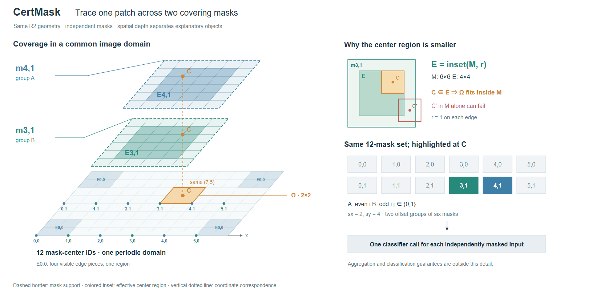

**安排：** 共享坐标时保留共同底面；平面到曲面时明确映射。用可追踪的局部内容和引线连接对应位置。

**取舍：** 同点追踪更直接；仍须区分物理深度与展示错位，完整分组或映射可能需要额外说明。

**各例依据：** [SAWR](cases/sawr.md) · [MROP](cases/mrop.md) · [Tetris3D](cases/tetris3d.md) · [Carrier](cases/carrier.md) · [AR-AWM](cases/ar-awm.md) · [Response Profiles](cases/response-profile.md) · [CamoShift](cases/camoshift.md) · [NORP](cases/norp.md) · [CertMask](cases/certmask.md) · [ReMoE](cases/remoe.md) · [UAtt3D](cases/uatt3d.md) · [AdvTiles](cases/advtiles.md)。

### 几何与读数：用同一实例解释约束

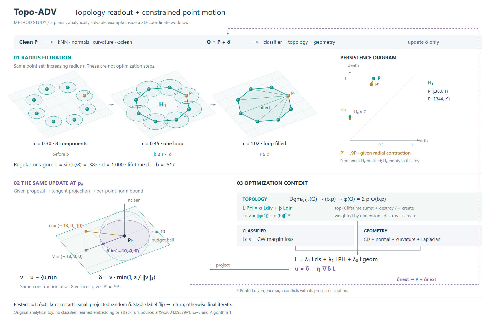

**安排：** 用局部坐标展开向量、曲面或凸包；数值、概率和区间保留正视，使用同一实例连接。

**取舍：** 几何需要明确坐标含义；小例子可能只覆盖部分结构。不能将说明性变化当成模型优化轨迹。

**各例依据：** [GCD](cases/gcd.md) · [MABT](cases/mabt.md) · [Illusion of Depth](cases/illusion-depth.md) · [AdvFM](cases/advfm.md) · [PA-Attack](cases/pa-attack.md) · [SLASH](cases/slash.md) · [Topo-ADV](cases/topo-adv.md) · [LETHE](cases/lethe.md) · [Anti-I2V](cases/anti-i2v.md)。

### 构造关系：对象而非模块成为主体

**安排：** 让具体轮廓、部件位置与合成结果成为主体，参数紧邻改变的位置，搜索或评分作为支撑路径。

**取舍：** 累计结构便于追来源，独立层便于隔离贡献；不能把递归层、优化轮次和物理叠层混为一谈。

**各例依据：** [AdvFractal](cases/advfractal.md) · [SmuDPatch](cases/smudpatch.md)。

### 分配关系：选中对象与应用范围分开

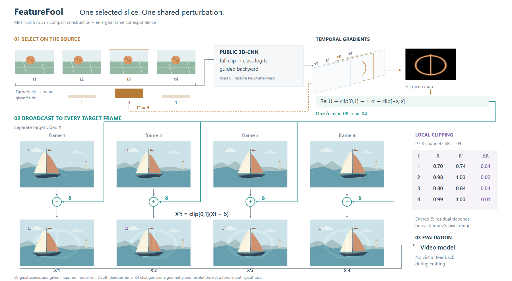

**安排：** 来源和受体按身份分开，共享值只出现一次，分配连接到实际运算处；门控条件与数据路径分别表达。

**取舍：** 共享线可能很长；共享条件与最终输出需分开。逐对象输出可不同，只对真正共享的量使用复制关系。

**各例依据：** [Ancestor VLM](cases/ancestor-vla.md) · [APC](cases/apc.md) · [FeatureFool](cases/featurefool.md) · [Detect and Suppress](cases/detect-suppress.md)。

### 同一对象的状态变化

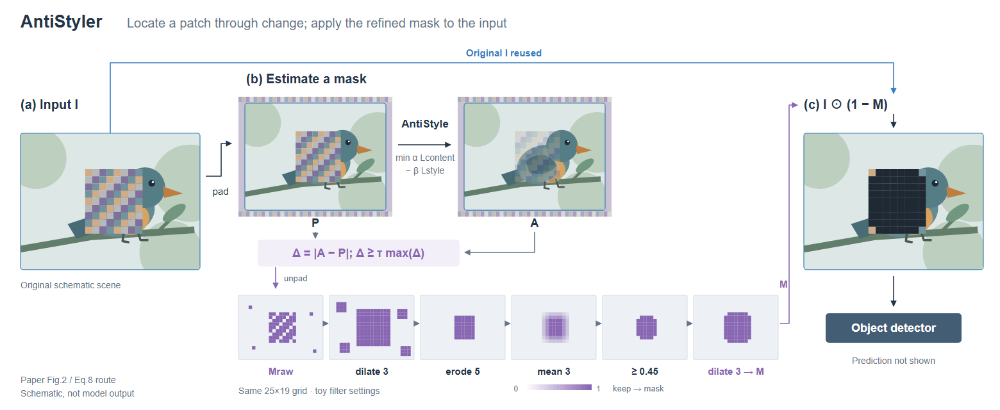

**安排：** 固定对象坐标和身份，直接展示状态变化；操作名放在变化之间，完整说明随图。

**取舍：** 便于比较局部变化，但状态太多会缩小对象。省略步骤时仍须交代其作用。

**各例依据：** [SRIM](cases/srim.md) · [SIGN](cases/sign.md) · [AntiStyler](cases/antistyler.md) · [D-Loop](cases/dloop.md) · [SmuDPatch](cases/smudpatch.md) · [PA-Attack](cases/pa-attack.md) · [PWaveP](cases/pwavep.md) · [DefenseSplat](cases/defensesplat.md)。

### 完整总览：共享状态成为主体

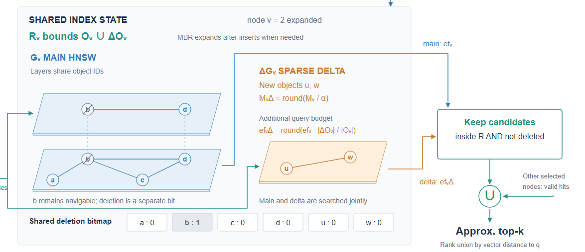

**安排：** 共同对象画在中心，构建、读取、更新围绕其真实接口组织，局部前后变化就近展示。

**取舍：** 共享关系集中，但容器容易暗示所有权；不能把并行或条件操作串成顺序流水线。

**各例依据：** [RaG-Tree](cases/ragtree.md)。

### 多视角与时间：层板和序列外框承担不同关系

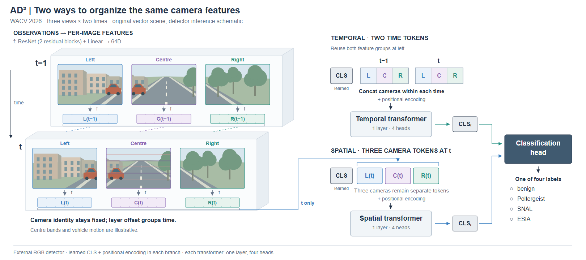

**安排：** 用位置和一种稳定身份色分别编码索引轴，再画真正进入计算的序列元素。

**取舍：** 索引复用能减少长线，但增加按ID查找。外框不能替代真实的元素数量。

**各例依据：** [View Swap](cases/view-swap.md) · [SAM-V](cases/samv.md) · [TARA](cases/tara.md) · [Anti-I2V](cases/anti-i2v.md) · [AD²](cases/ad2.md) · [M2Patch](cases/m2patch.md)。

### 开放文本：让变化本身成为主体

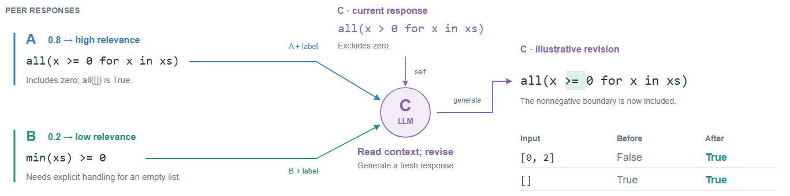

**安排：** 将内容和修改位置展开，角色与操作退为短标签；实际输入和输出保持可见。

**取舍：** 内容突出，但长文本会占面积；论文若创新在完整提示结构，仍须保留该结构。

**各例依据：** [GoA](cases/goa.md) · [MEMO](cases/memo.md)。

### 局部空间：让一组关系形成主视觉

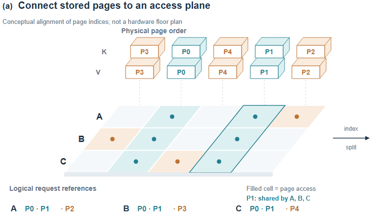

与正视图保持相同页ID、列序和访问关系，用共同投影形成整体。适合小范围存储、特征面和取样关系；密集数值读取保留正视。详细取舍见 [FlashInfer](cases/flashinfer.md)。

## 从构图到视觉重点

- **面积给操作和实例。** M2Patch 放大空特征面没有改善对齐解释，后续把比较操作移到两个对象之间。对象大不等于机制清楚。[LETHE的面积重分配](cases/lethe.md#压缩上下文把面积还给读数)则收拢普通上下文，让同一矩阵数字和几何变大；记录同时变小的人物与流程，不能只凭画布变矮判定改善。
- **局部展开按操作选择。** 连续区域用全幅定位与同域裁切，如 [DefenseSplat](cases/defensesplat.md) 的邻域保留；离散对象展开索引对应的运算，如 [PA-Attack](cases/pa-attack.md) 的两阶段权重×目标项。比较保持标尺与身份，其他对象仍参与完整计算。
- **重复操作按阅读任务展开。** [PWaveP](cases/pwavep.md#代表性展开把重复操作让出的面积交给关键运算) 用单点运算配完整编辑总览，保留不同选带与作用范围。它更突出执行过程，但省略其他行的幅度；差异本身重要时仍应并排展示。[ReMoE](cases/remoe.md) 需中心内外点对才能解释覆盖差异，保留全体支持域；代表性展开不等于只能选一个对象。
- **几何约束可以直接组织布局。** [UAtt3D / FIR](cases/uatt3d.md) 把三个正交起点平面放在同一对象周围，再展开一个实际交点；取样、投影和相交无需一律排成重复对象的流程。只展开局部时明确范围。[ReMoE共享主体](cases/remoe.md#同一主体承载覆盖和相加) 则把特征贡献放回原patch位置，减少跨面板查找；其高度表示数值，不能与分支层号混用。[Detect and Suppress](cases/detect-suppress.md#把局部对象放进运算节点)则让局部特征对象承担干预节点，省去重复状态；代价是主干转弯和同名控制信号的对应。
- **突出一种主关系。** 色彩优先跟踪身份或状态；文字、连线、容器不必同样醒目。图像保留内容色，辅助网格与非焦点区域降低对比。
- **按内容安排边界。** AD² 的连续条与分离块表达不同元素数量；[SmuDPatch](cases/smudpatch.md) 的轮廓本身是研究对象，可放大为主体，让参数与约束围绕它组织。普通模块压缩，但仍保留改变该对象的操作。
- **重复绘制保持同一对象。** 原创示意可复用几何定义，场景补表面细节；实测输出保留实测形状。比较重叠使用共同坐标窗口，避免逐个居中裁切改变关系。见 [UCD](cases/ucd.md)。

按[基础配色约束](visual-first-layout.md#基础配色约束)用中性色、主色与强调色建立主次；参考案例或绘图组件自带的蓝/青/橙/紫不作为默认整图色板。具体图片提示词可调整色系和风格。设计阶段即按[目标论文版面](visual-first-layout.md)决定尺寸与可读性；只有需要特定交付格式时再读[工具与导出](tooling.md)。

## 空间一致性

同一对比组从共同投影计算顶点。一个等轴测起点是：

`u = ox + s*cos(30°)*(x-y)`

`v = oy + s*(0.5*x + 0.5*y - z)`

x/y在底面、z向上，画布v向下。不同子图可换表示，但保留共同坐标方向、对象ID与已说明的深度含义。真实相机关系采用论文的投影与参数。

| 局部对象 | 需要保留的含义 |
|---|---|
| 体素、特征层片 | 空间轴与通道轴分清；示意格数不冒充真实尺寸 |
| BEV聚合、投影、反投影 | 操作与射线有明确去向；外形变扁不等于已说明聚合 |
| 三平面 | 三正交面有共同坐标；相交处拆面，避免整面覆盖造成错误遮挡 |
| 高斯/点 | 椭圆可作示意；真实协方差投影由数据与局部雅可比计算 |
| 共同坐标展开 | 显示高度与数据坐标分开；坐标对应线不暗示数据传递 |

### 透明体素

背景面透明度可从0.03–0.07、后侧网格0.10–0.18、前侧网格0.22–0.35、关键体素0.30–0.60起调。这些仅是视觉起点；透明度编码数据时遵守数据标尺。

优先外表面、切片或少量有含义体素。重复透明内面会使中心叠色发脏。面片按视深排序，相交面必要时拆分；不透明物体只画可见外表面。标签和关键点保留清晰对比。显示间距应容纳边缘、标签与引线；调整展示位置时保持数据关系。

### 紧凑论文排版

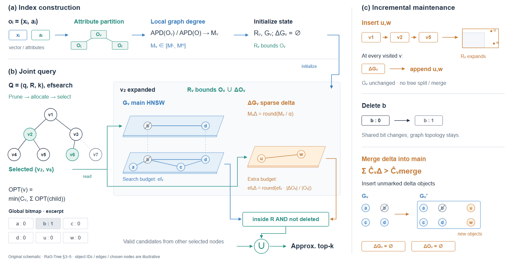

主图保留对象身份、核心操作、关键分支和出口；长推导、来源、示意设置和次要细节放图注/正文。局部需进一步展开时另设细节图并引用，明确总览与展开各自承担什么；不能暗删核心机制，也不要求一张图承载所有实现细节。

压缩来自重排来源与操作、合并重复表示、区分主次，不是一律缩小文字。与正文合读可用更短图内说明，独立讲解可更充分。两种取舍见 [RaG-Tree](cases/ragtree.md) 与 [M2Patch](cases/m2patch.md)。
