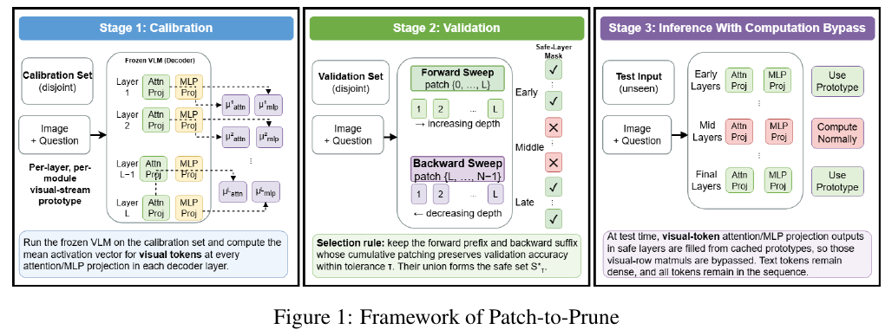
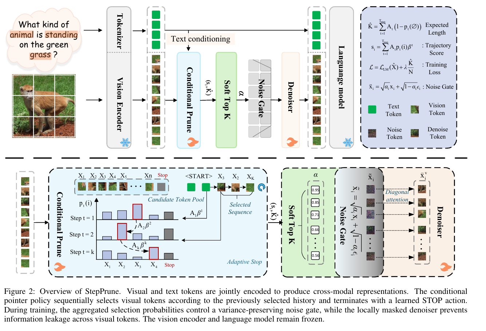
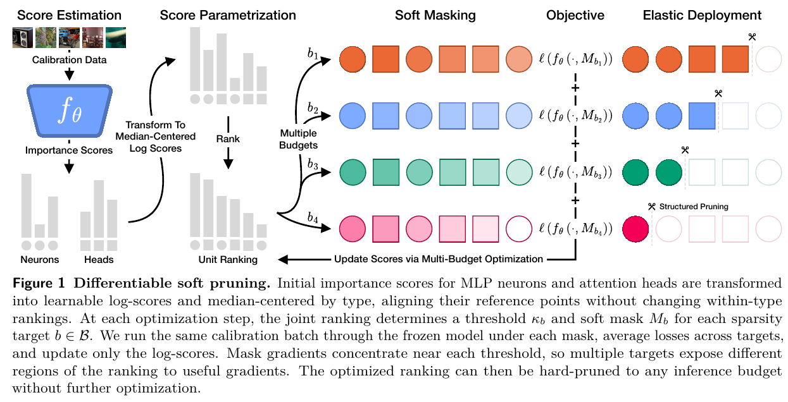

# 从阶段总览到操作主体：三种原图组织

当方法已读懂，却仍画成几个等重说明区时，按读者要比较的关系选参考。以下为原论文图形研究，不是本项目原创试画，也没有四评委质量分。实际使用前查看对应图片；文字摘要不能代替看图。

| 当前阅读任务 | 优先看 | 借用的关系 |
|---|---|---|
| 准备阶段产生什么，部署阶段怎样使用 | P2P | 阶段、数据划分与缓存的去向 |
| 总览中的模块内部究竟发生什么 | StepPrune | 总览接口连接候选、历史、选择与停止的局部 |
| 同一组对象在不同条件下如何变化 | Elastic | 共享排序和稳定身份，多条件沿另一轴比较 |

## P2P：阶段分工明确，不代表关键操作已足够大

[From Patching to Pruning Visual Computation in Vision–Language Models](https://arxiv.org/html/2610.03389v1)，2026-10-02，PDF p2 / Fig.1。

原图将校准、验证、推理放在三个等宽区域。数据来源、均值缓存和安全层选择的阶段关系清楚；实际投影替换仍较小，需要配合文字读取。

**适用决定：** 如果任务主要是交代准备与部署，可借阶段边界。若要解释“绕过什么计算、保留哪些 token”，让缓存读取、被绕过的投影和保留的序列成为主对象，准备阶段提供参数来源。不要把七种投影画成虚构的并联网络，也不要用剪掉 token 的外观代替投影输出替换。

**代价：** 机制展开会占用阶段说明的面积；保留缓存与安全集合的同名接口，避免主图像脱离配置来源的独立算法。

**已试用：** [P2P原创两版](cases/p2p.md)采用token×深度和同层展开，四评委确认其推理解释有效；初稿仍漏掉候选到边界的对应，经过一次重绘改善。这个结果支持具体组织与修订，不能证明本参考提示导致分数提升。

## StepPrune：从模块名进入内部对象

[StepPrune: Adaptive Sequential Visual Token Selection across Multimodal Large Language Models](https://arxiv.org/html/2609.13804v1)，2026-09-12，PDF p4 / Fig.2。

上部给训练路径，下部展开条件指针的候选池、历史、逐步概率及 STOP，另展开噪声门与逐 token 去噪。输入照片提供语境，内部变化获得主要解释空间。

**适用决定：** 用总览定位一个操作，再以相同对象身份展开输入、状态变化与返回位置。扩大的是操作本身，不只是更大的模块框。必要时以少量代表候选显示历史如何改变下一次选择，同时保留终止出口。

**代价：** 总览到局部需要一次阅读跳转。对应标记要明确，不能把两个视图误画成两次串行调用。训练噪声门和推理 token 选择有不同职责；不要因原图组织便利而混为同一动作，也无需照搬竖排文字或上下两层。

## Elastic：把多条件变化画在同一组对象上

[Your Transformer Is Secretly Elastic](https://arxiv.org/html/2610.20588v1)，2026-10-14，PDF p1 / Fig.1。

校准图像是小入口；分数经过对数与中位数中心化，形成共享排序。多个预算行沿同一单元顺序排列，软 mask、各自损失与硬剪枝对齐，更新回到分数。不同形状区分神经元与注意力头。

**适用决定：** 多条件作用于同一对象时，先固定身份，再沿另一轴展示条件差异。每个条件不必另画整座网络。若需要立体，可用浅层表示组别，数值与精确比较保持正视；深度不能暗示不存在的时间或网络层次。

**代价：** 行列对齐强化跨条件比较，却可能让排序构造和阈值来源退到背景。原图没有展开 FLOP 成本如何决定各预算阈值；若新图负责完整方法，需要补出这个操作，不能把总览当作完整推导。多预算行也不是训练时间轴。

## 借用后的落图决定

在 brief 中只需说明哪种关系适合当前任务、具体哪些对象承载它，以及保留哪些接口。可以组合：阶段带交代配置来源，共同对象构成主体，局部展开解释一次操作。不要为了用全三种参考而加面板。

上述是原图中可观察的组织，是否改善新图仍需看实际图稿及独立评审。已有规划能正确选择主对象时，不追加同义口号；优先检验实际字号、面积、对象对应和阅读路径。
