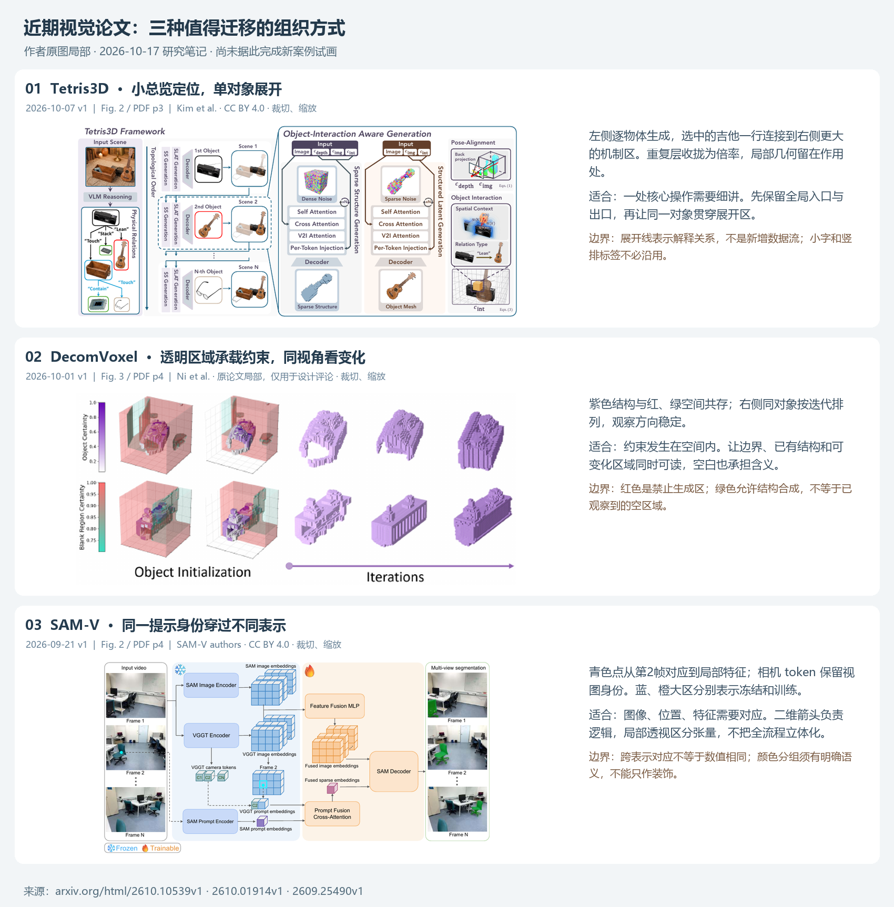

# 跨领域参考图谱

截至 2026-10-18，查看原 PDF 后持续整理。页码为文件页序；以下是设计分析，不代表作者软件或原图全为矢量。按问题选参考，不作美观排名。

## GCD：用同一查询对解释分数变化的作用

[论文](https://arxiv.org/html/2610.17382v1)，2026-10-12。实际看PDF p9/Fig1：多组极坐标统计比较梯度方向，提供实验分布而非三维方法构造。[原创试画](cases/gcd.md)改用显式解析分数面、固定查询对和同源概率条解释一次接受判断，未复刻论文实验数据。此例说明原图无需三维；新图的空间高度只有在对应具体margin读数时才有解释作用。完整方法仍需另读§4.2的构造关系，不能只借原图的方向主题。

## MABT：概念曲面不能替代算子保证

[论文](https://arxiv.org/html/2609.38991v1)，2026-09-30。实际看PDF p1/Fig1：三组网格曲面、模型边界与轨迹分别组织动机，颜色和箭头标记离面与锚定。正文说明实践MAP不等于精确投影，因此[原创试画](cases/mabt.md)借几何层次，改用显式松弛算例和独立预算立方体，端点不强行贴面；求值输入和算法状态在二维区展开。

## View Swap：相机列固定，样本内容替换

[论文](https://arxiv.org/html/2609.33707v1)，2026-09-27。实际看PDF p6/Fig2及p21/Fig6：前者将相同观察拆成不同机制；后者按相机列排列真实视图，固定一列、替换另一列，并以边框和来向标出供体。借用固定角色的前后比较，[原创试画](cases/view-swap.md)再展开来源身份与目标归属，三维仅解释相机语境。

## SAWR：总览与正文中的非对称监督

[SAWR](https://arxiv.org/html/2606.08745v1)，2026-06-07。实际看PDF p6/Fig2：冻结teacher、student、编码器/解码器与染色/小波区域分开，真实图像提供语境。正文Eq5–7更具体地区分H全部两层子带与E第一层低频；原图最深低频标签有歧义，[原创试画](cases/sawr.md)按正文展开，完整递归输出与计分集合分别连线。借层级与训练职责，不照搬对称分支。

## MROP：阶段分工与局部支持域

[MROP](https://arxiv.org/html/2609.00786v1)，2026-09-01。实际看PDF p3/Fig2：检测、掩码定位、残差恢复按阶段展开，图像状态和返回变量各在对应模块中，发送端本地仿真区别于最终传输。[原创试画](cases/mrop.md)借两阶段职责和本地调用，主视觉改为Phase 2共享坐标的可改域与补集比较域，全图TV另标；不是复制原图三块同等面积。

## WebMirage：同一商品与执行字段

[WebMirage](https://arxiv.org/html/2610.09240v1)，2026-10-07。实际看PDF p5/Fig3、p7/Fig4：前者以同一商品在不同页面位置解释兼容槽位，后者用原始输出、解析代码和字段提取连接到执行。借具体内容、当前映射与字段传播，不照搬整幅架构。[原创试画](cases/webmirage.md)以同一杯子在两行页面中的编号变化贯穿目标与解析；体积造型用于识别对象，表与文本保持正视。

## ProAda：问题内容与连续候选

[ProAda](https://arxiv.org/html/2610.16622v1)，2026-10-12。实际看PDF p4/Fig2：共享视觉输入、两类具体问题、冻结模型与不同目标并置，文本判断局部含回退。整体并置不决定更新顺序，须读Algorithm1。[原创试画](cases/proada.md)借具体内容解释角色，嵌入候选另用明确的独立线性边界，H/G图像步骤按算法串行，未将训练分类器放到最终部署路径。

## IAU-FOA：总览中的局部求解

[IAU-FOA](https://arxiv.org/html/2610.06977v1)，2026-10-04。实际看PDF p4/Fig2：增强复制、代理集合、局部/全局特征和加权分区说明整体；聚类连线只概括对应，求解细节仍在模块中。[原创试画](cases/iau-foa.md)保留整体定位，展开同一三维算例的S、P*、归一化权重和直接相似度支路。此借用不要求把特征画成立方体，也不意味着原图已经展示反传边界。

## Illusion of Depth：同源局部与完整搜索

[Illusion of Depth](https://arxiv.org/html/2609.16336v1)，2026-09-14。实际看PDF p4/Fig4–5与p5/Fig6：Fig5把影像条带与选取块并置，Fig6让完整代价曲线和局部低谷互相解释。可借同源取块和全局/局部的分工，不把展示的两个候选当完整搜索。[原创试画](cases/illusion-depth.md)只展开采样分支，用解析算例连接灰度、整数SAD和深度；不是原论文实验复现。

## RILA：物理接口与采样事件

[Physically Real-time Infrared Attack against Optical Flow Estimation Networks](https://arxiv.org/html/2607.26651v1)，2026-07-29。实际看Fig.2 / PDF p3与Fig.3 / p4：前者将采样时间和序列并列，后者将灯光实体放入GA评价环。可借时间/空间分工；Fig.2合并的GA/AGN节点较概括，不能据此给在线AGN补图像输入。[原创试画](cases/rila.md)按§4.3及Algorithm 1区分向量递推、物理捕获与两帧估计，fitness不明项保持符号。

## 近期对抗原图：威胁模型与内部机制的分工

[Ancestor VLM攻击](https://arxiv.org/html/2610.09708v1)，2026-10-07，实际查看Fig.1 / PDF p3。原图把公共资源、贴片、相机、目标与失败场景分开，直接交代可访问边界；没有展开内部目标。可借用的是资源和部署端的关系，不是失败图片作为证据。[原创试画](cases/ancestor-vla.md)保留小总览，再用共享权重带展开IGS；自主算例与场景分开，不伪造模型失败结果。

## 近期视觉原图：主次、约束与身份

板中三例是§89的原图研究快照，裁图用于参考评论，不作为新图资产。后续已用[Tetris3D原创场景](cases/tetris3d.md)试用总览与展开提示；[SAM-V原创试画](cases/samv.md)也已完成一次视图身份/局部位置展开；DecomVoxel仍只有参考研究。不能把三篇都计入原创案例。

| 原论文与实际查看位置 | 可借的动作 | 适用边界 |
|---|---|---|
| [Tetris3D](https://arxiv.org/html/2610.10539v1)，2026-10-07 v1，Fig.2 / p3 | 小总览定位一个物体的生成，再连接大幅机制展开；同一吉他贯穿两级，重复层收拢 | 一处核心值得详讲时采用。展开边界与数据箭头分清；不必继承竖排小字。与已有 Engram/Aurora 的组织相呼应，并非必须使用的新模板 |
| [DecomVoxel](https://arxiv.org/html/2610.01914v1)，2026-10-01 v1，Fig.2–3 / p4；板中为 Fig.3 | 透明约束区容纳可辨认的结构；同视角排列迭代状态 | 紫色保留已确认结构，红色禁止生成，绿色允许合成。绿色不等于已观察到的空区域；原图的真实补全结果不能移植成原创示意的实验结论 |
| [SAM-V](https://arxiv.org/html/2609.25490v1)，2026-09-21 v1，Fig.2 / p4 | 相同提示点对应图像与局部特征，相机 token 保留帧身份；冻结/训练区域有语义 | 适合追踪跨表示对象。特征透视不是物理空间；这是身份和分组参考，不能据它声称整图已有强烈的单一主视觉 |

### 待迁移的提示：从同等分区转向总览与展开

> 当多个机制区同等抢眼时，比较“按阶段均匀展开”与“小总览定位、围绕一个对象展开”。选后者时，写明总览里展开哪一步、哪些对象保持身份，以及局部产物接回哪里。把面积用于解释运算；普通步骤收拢，主要分支与出口保留。透明区域和透视只承担明确的空间或数据含义。

这是原图启发的候选提示，已在[Tetris3D](cases/tetris3d.md)进行一次试用：同ID体素连接场景与条件，总览和两阶段出口保留；轮廓仍有被误认为完整输入的风险，R2补明确区分。仍需观察跨论文迁移，不凭一次图稿或研究板认定普遍有效。

## 按设计问题继续选择

| 设计问题 | 参考 | 转用的关系 |
|---|---|---|
| 局部操作和整体结果易混 | PWaveP Fig.1 | 临时重建保留全部ID，删除发生在随后 |
| 单例不足以解释差异 | ReMoE Fig.2 | 共享坐标中的多种覆盖与中心内外对照 |
| 核心只有模块名 | Engram Fig.1 | 小总览定位 + 大机制展开 + 输入实例 |
| 细节挤成一条线 | Aurora-X Fig.2 | 总览与局部机制分层、同色回指 |
| 分支区别不清 | MoR Fig.2 | 同一 token、不同路径、矩阵补充 |
| 表示转换抽象 | FlashInfer Fig.2–3 | 逻辑与物理视图的对象对应 |
| 图方法只有一团节点 | GoA Fig.2 | 选择依据→图结构→阶段更新 |
| 两次筛选容易混为一谈 | PCTree Fig.2–3 | 父条件化对照、树→候选选择→掩码 |
| 保留的内容被误当成已确认输出 | D-Loop Fig.1 | 共享 drafter、硬 token 状态切换、后续验证 |
| 同一系统包含不同层级和空间 | RaG-Tree Fig.1 | 属性分区、树节点、局部 HNSW 分层分别组织 |
| 高维内容是否必须 3D | DiffTrack Fig.2 | 二维矩阵表达高维关系 |
| 需要透明体素、三平面 | [空间参考](paper-references.md) | ALOcc、TriTex、GaussRender 的局部几何 |

## Engram：输入实例与核心展开
[论文](https://arxiv.org/abs/2601.07372)，2026 年预印本，Fig.1，p3。
- 观察：窄骨干定位插入位置；大区域从 token 窗口经过哈希和叠层嵌入到融合。相同 token 在整句与窗口中出现，虚线连接定位与展开。主要是二维逻辑。
- 转用：核心模块展开为中间对象，一个小实例贯穿总览与局部，适合查表、检索、路由和压缩。
- 边界：窗口数量、算子和流向属于本论文；增加侧面厚度不能替代机制展开。

## Mixture-of-Recursions：路径与矩阵互补
[论文](https://arxiv.org/abs/2507.10524)，2025 年预印本，Fig.2，p4。
- 观察：两种路由并列，同样 token 符号贯穿各层；虚线空心与填色区分状态，右侧 query/key 矩阵解释缓存。
- 转用：比较算法时输入对象保持一致，把决策导致的不同路径画出来；密集对应交给矩阵。
- 边界：必须标出矩阵行列；格子配色不随意冒充真实权重。

## Aurora-X：把面积留给机制
[论文](https://arxiv.org/abs/2609.31038)，2026 年预印本，Fig.2，p4。
- 观察：顶部紧凑流程，下方展开块结构、路由和预测头。同色在总览与展开复用，重复块用倍率标记，训练专用机制置于局部底部。
- 转用：压缩普通阶段，展开创新；相同块不全部复制。
- 边界：三列不是模板；原图小字和阴影不必继承，一处核心可占两列。

## FlashInfer：对象跨视图对应
[论文](https://arxiv.org/abs/2501.01005)，MLSys 2025，Fig.2–3，p4，查看 v2。
- 观察：逻辑 cache 页、物理块与稀疏矩阵共同解释表示；另一图拆开共享与独有部分，对应访问与合并。颜色跟踪类别。
- 转用：系统图画实际映射、共享、拆分或调度，二维访问路径配局部存储层叠。
- 边界：原图标注较密；借逻辑而不复制密度。示意矩阵仍需索引含义。

实际迁移时发现：比较逻辑页、物理页与访问矩阵，应保留相同页 ID；分解的是访问索引，不能用数据搬移箭头暗示缓存被复制。对应试画推理见 [系统案例](cases/flashinfer.md)。

## Graph-of-Agents：从选择依据到运行结构
[论文](https://arxiv.org/abs/2604.17148)，ICLR 2026，Fig.2，p4；动机对比见 Fig.1，p2。
- 观察：窄总览旁展开模型卡、评分表、图通信与输出整合；对象图标贯穿不同表示，两个通信阶段分别展示。
- 转用：给选择、构图、传播可见依据；节点身份和位置保持稳定，突出变化的边。
- 边界：减少原图小字与复杂图标，用短 ID。max/mean 是该文的响应整合方式，不泛化为任意向量逐元素运算。

继续读附录得到的机制细节：响应权重通过相关性文字标签进入提示；局部展开应显示提示的组成，而不是只翻转图边。见 [节点更新案例](cases/goa.md)。

## DiffTrack：二维矩阵表达高维机制
[论文](https://arxiv.org/abs/2506.17220)，2025 年预印本，Fig.2，p3。
- 观察：帧与文本的 query/key 交互按矩阵分区，用颜色和边框区分类别。图本身二维。
- 转用：成对关系适合正视矩阵；需要解释张量来源时另加局部空间对象。
- 边界：示意分区不是数值热力图，不能凭配色制造注意力强弱。

## PCTree：选择阶段与共享条件

[论文 v1](https://arxiv.org/html/2608.02123v1)，2026-08，实际查看 Fig.2 p5、Fig.3 p6。
- 观察：Fig.2 并列对比共享位置分布与逐父条件化，右侧 shared logits 分叉给不同父节点。Fig.3 用连续小树、frontier 列表和 attention mask 说明不同阶段。
- 转用：同 ID 跨树和矩阵保持对应；共享输入与各自变化的条件应分开表达。为避免原图中 prune 被误读为从候选池删除，可增加“停扩但最终入选”的实例。
- 边界：这是一张方法图的组织参考，不是三维风格参考。我们的局部薄片是新构图选择；不能推断作者使用的绘图工具。见 [迁移案例](cases/pctree.md)。

## RaG-Tree：两种层级分别表达

[论文 v1](https://arxiv.org/html/2608.01255v1)，2026-08 预印本，实际查看 Fig.1，PDF p3。
- 观察：左侧对象分组、中央 R-tree 选择、右侧分层 HNSW 共同组成总览。红色标出选择的树节点；右侧以斜平面分开局部图层。两种层级没有直接叠成一张空间树。
- 转用：分开属性过滤的几何、对象集合包含关系和向量图拓扑；用集合/图 ID 连接。将选择的父节点与未单独搜索的后代保留在同一视图，说明覆盖关系。
- 边界：HNSW 图中位置是拓扑排布，不能当成属性坐标或未经计算的真实向量投影。小图节点数、边和查询结果都应说明是示意。成本选择需要符号条件或原文数据，不能为凸显优化效果编造时延。

## D-Loop：共享参数与离散提议状态

[论文 v1](https://arxiv.org/html/2610.06011v1)，2026-10-05 预印本；实际查看 Fig.1，PDF p4。
- 观察：左侧单次草拟，右侧通过同一个 drafter 的两条路线展示初稿、保留前缀、重掩码与再生成；目标验证在之后。颜色和 Pass 1/2 标签承担调用区别。
- 转用：保留相同参数对象，明确两次输入状态改变了什么。重复的 token 位置可改为对齐的状态行，以便读者追踪被复制与被替换的内容。
- 边界：retained prefix 仍是未验证提议，不能仅因保留就标作 accepted。本文的循环是硬 token 重嵌入，不是连续隐藏状态迭代；不为“因果条件化”擅自添加三角 attention mask。完整例见 [状态案例](cases/dloop.md)。

## MAC：图像空间操作与特征空间依据

[论文 v1](https://arxiv.org/abs/2606.06938)，CVPR 2026；实际查看 Fig.3，PDF p3。
- 观察：原图用重复的同场景照片表示增强视图，三个编码器图标对应不同输入状态；上路探测腐化程度，下路求解反向扰动，两者在最终输入更新处汇合。雪花标记编码器冻结。
- 转用：沿 view ID 追踪图像、特征与标量。把“用于决定修改的依据”和“实际被修改的对象”分开；局部矩阵表达 N×D，图像算术保持正视。
- 边界：corruption weight 是逐视图标量，在像素和通道上广播，不是 attention map；最后平均的是各视图的 class scores。公式中两特征共享基准范数，不能画成分别单位化。见 [视觉防御案例](cases/mac.md)。

## PA-Attack：来源、作用位置与重新估计

[论文 v1](https://arxiv.org/abs/2602.19418)，2026-02；实际查看 Fig.3，PDF p4。
- 观察：上方整行展示干净/对抗图像的特征、独立 guidance dataset、feature memory 与 prototype；下方两块分别解释 token attention 来源和第二阶段重新提取 attention。特征用窄立体条表达，原型用概念球面表达。
- 转用：用大子图交代目标依据，再用小子图解释同一权重如何获得和刷新。图像 patch 与 token 对应应能追踪；两阶段图保留中间对抗图像作为重新估计的实际输入。
- 边界：球面只是概念结构，不能当作实际嵌入坐标。不能把 dataset prototype 简化为任意目标类别图片。试画继续读正文/作者代码后，发现聚类在 PCA 表示中确定成员，原型平均原始 token 张量并保留位置；注意力作用于 token loss 而非直接乘像素。见 [PA-Attack 试画](cases/pa-attack.md)。

## AD²：视角与时间是两个索引轴

[论文 v1](https://arxiv.org/abs/2602.10160)，WACV 2026；实际查看 Fig.4，PDF p5，并读 §3.2.3。
- 观察：输入按三摄像头×两时间点排成 3×2 图像阵列；空间支路取当前时刻的三视角，时间支路按时间组织串接后的多视角向量，两个 transformer 汇入分类头。
- 转用：先确定哪些索引保留、哪些拼接，再选择正视阵列或浅层叠片。可以用明确视角/时间编号将场景卡、向量和两个支路连接。
- 边界：时间层叠不代表真实三维空间；检测输出是 benign/三类攻击，不是修复图像或车辆轨迹预测。试画用双时间板及同色相机特征保持索引，空间支路保留当前三相机 token，时间支路先按时刻拼接。见 [双时间板案例](cases/ad2.md)。

## AntiStyler：区域演化与最终作用对象

[论文](https://openaccess.thecvf.com/content/CVPR2026/html/Yankelev_AntiStyler_Defending_Object_Detection_Models_Against_Adversarial_Patch_Attacks_Using_CVPR_2026_paper.html)，CVPR 2026；实际查看 Fig.2，PDF p3，并读 §4.1–4.4。
- 观察：原图将随机填边、AntiStyle、差异计算与掩码处理串联；掩码处理又展开为多个局部状态，最终负掩码与原输入结合。
- 转用：把局部区域的变化画成同坐标小图序列；保留估计掩码所用图像和最终被遮挡图像的区别。过滤前后使用同一示例，变化应能追踪。
- 边界：论文公式与演示代码在阈值定义和最终图像来源上有差异。试画明确按 Fig.2/Eq.8，原始图像和 mask 均为示意，不能据此宣称恢复或检测成功。见 [掩码案例](cases/antistyler.md)。

## UCD：总体架构与不同类型的局部目标

[论文 v1](https://arxiv.org/html/2608.05983v1)，2026-08；实际查看 Fig.1，PDF p3。
- 观察：上方共享图像/文本条件路径，下方给出概念、特征与掩码的局部变化；presence 与候选分数相乘，用不同色箭头区分架构与优化。
- 转用：不同作用对象采用不同表示。分数广播适合表，空间重叠适合掩码和矩阵，特征通道可用局部薄片。
- 边界：原图输入含负概念示例，但正文训练目标针对正提示；不能单看图就把负提示纳入训练。按公式区分 top-k 与最终阈值，不能把 Dice 最大重叠误画成一一匹配。见 [UCD 试画](cases/ucd.md)。

## CertMask：把覆盖条件画成可行中心区域

[出版页](https://ojs.aaai.org/index.php/AAAI/article/view/37716)，AAAI 2026；实际查看扩展版 Fig.1/p2、Fig.2–3/p3。
- 观察：总览用同一图像的多个遮挡版本表达独立推理；几何图用内缩阴影区解释补丁中心的位置限制，并以尺寸线表达半径。
- 转用：将“覆盖一个有面积对象”改画成“判断中心是否处于可行区域”，再连接到位置布局。深度可用于分开组，几何判定保留二维正视。
- 边界：中心位于mask内不充分，必须位于内缩区域。几何覆盖与分类证书属于不同层次，局部图要说明范围。试画的周期边界片段保留同一ID，见 [CertMask 案例](cases/certmask.md)。

## DefenseSplat：频率对象与空间场景互补

[论文 v2](https://arxiv.org/html/2602.19323v2)，2026-06-27；实际查看 Fig.2，PDF p4。
- 观察：频率过滤与三维优化分成两区；低频旁路、高频阻断与局部尺度椭球各自承担明确含义，场景周围放置视图。图中有较多图例和容器。
- 转用：不同对象采用相应表示，系数变化用二维面，空间尺度用局部几何。共有分量保留实际旁路。
- 边界：v2正文§3.4增加可选细筛选，Fig.2未展开；不能只照总览图认定方法范围。原创试画将两种选择并列，见 [案例](cases/defensesplat.md)。

## SmuDPatch：轮廓候选与两阶段组织

[作者项目与论文](https://github.com/visheshrajput2408/SmuDPatch)，ECCV2026；实际查看Fig.2，PDFp5。
- 观察：左侧以轮廓群体、亲代子代、适应度串联形状搜索，右侧展示仿射样例与纹理训练回路。彩色补丁对象提供辨识度。
- 转用：用实际对象变化替代空模块，区分评价候选的内循环和固定对象后的最终训练。主图面积可重新分配给原图未展开的几何约束。
- 边界：正文才明确25个固定角锚点、等面积缩放与短暂纹理训练；不能仅从形状图猜测其可训练参数。见 [轮廓试画](cases/smudpatch.md)。

## AdvTiles：图案身份贯穿选择、铺面与衣物

[论文v1](https://arxiv.org/html/2608.06801v1)，2026-08-07预印本；实际查看Fig.2/PDFp3、Fig.3/PDFp4。
- 观察：Fig.2用多行容器覆盖生成、渲染、背景和损失；Fig.3以参数前后图、logit层叠和铺面表达选择。原图将人体、图案和背景实例嵌入流程，内容比纯模块更丰富。
- 转用：保留一种真实内容跨不同表示的身份，局部选择可由二维图解释，映射结果用空间对象承载。图案重复必须来自同一对象。
- 边界：正文明确ST前向每格选一块，软概率用于反向；不能把温度示意理解为空格逐渐填满。兼容边缘与颜色接缝也有不同目标。见 [原创试画](cases/advtiles.md)。

## UAtt3D：共享物体与取样平面

[CVPR2026论文](https://openaccess.thecvf.com/content/CVPR2026/papers/Fan_Good_Can_Sometimes_be_Bad_A_Unified_Attack_against_3D_CVPR_2026_paper.pdf)，实际查看Fig.2–3/PDFp4。
- 观察：Fig.2将对象放在外接球内，以取样起点平面包围，右侧分出训练/推理用途；Fig.3另外解释梯度与射线投影两个向量。
- 转用：一个空间对象可承担多个观察或取样关系；图形安排可直接遵从几何约束，减少复制对象和流程容器。局部放大保留真实三角面与射线关系。
- 边界：球面、物体表面与起点平面不同；同一面的射线平行，三个面相互正交。仅画FIR不能代表完整攻击，参见 [局部机制试画](cases/uatt3d.md)。

## PWaveP：按表示区分选择与最终作用

[论文v1 / WWW2026](https://arxiv.org/html/2602.03333v1)，2026-02-03；实际查看Fig.1/PDFp3。
- 观察：两排模块按回折顺序布置，输入/输出兔形点云提供对象身份。临时点云、删除和最终输出分开，但中间频带选择仍是模块名。
- 转用：从原图顺序提取不可省的中间状态，把主面积重新分配给正文中的实际修改对象；用ID连接系数与空间对象。
- 边界：原图的顺序不能简化成三风险组在空间独立处理；逆变换先整合全部系数，再删除高风险ID。见 [原创试画](cases/pwavep.md)。

## ReMoE：同一图像承载不同覆盖，正文补足回填关系

[CVPR2026论文](https://openaccess.thecvf.com/content/CVPR2026/papers/Zhong_ReMoE_Region-Mixture_Experts_for_Adversarially-Robust_Vision_Transformers_CVPR_2026_paper.pdf)，实际查看Fig.2/PDFp3与方法公式p4。
- 观察：同一猫图在全局、中心和四区域之间复用，专家小图标并列，损失放在右侧；R2P以竖条模块概括。
- 转用：保留共同内容/位置以比较覆盖，用正文的索引回填和零填充替代抽象模块。不同支持域不应因为算子重复就全部压成单例。
- 边界：新图只展开Eq.8–10，路由和训练不在范围。正文与代码的部分行为不一致，来源选择见 [案例](cases/remoe.md)。

## Detect and Suppress：场景提供背景，机制在表示内部

[论文v1](https://arxiv.org/html/2610.03498v1)，2026-10-02；实际查看Fig.1/PDFp1。
- 观察：攻击场景、SAE诊断、在线干预三组排列，实际机器人图像承担任务语境，内部特征以少数神经元符号概括。
- 转用：应用场景可压成小背景，让正文中的池化、选中特征与条件运算成为主图。三维可表示特征的代数关系，不必表示物理场景。
- 边界：成功轨迹不能移植成新图的实验结论；probe与SAE是不同分支。当前图只展开在线干预，参见[试画及候选取舍](cases/detect-suppress.md)。

## SIGN：图像提供语境，但局部算子需要正文补足

[论文v1](https://arxiv.org/html/2605.27927v1)，2026-05-27；实际查看Fig.1/PDFp2。
- 观察：整体分威胁场景、两阶段机制与优势指标；同一猫图多次出现，结构先验图与局部处理用浅紫/浅绿区分。信息很多，局部选择却主要由文字框表示。
- 转用：保留可识别场景，用正文操作展开真实邻域、候选状态与像素内容，避免只增加框和指标。
- 边界：图中的Top-K/Top-k AND与正文顺序描述不完全相同；先验不是猫的语义区域。当前试画按Eq.7–8并只展开局部，见[来源选择与实例](cases/sign.md)。

## AD-SRF：完整架构中的推理与交替训练

[论文v1](https://arxiv.org/html/2610.12897v1)，2026-10-09；实际查看Fig.2/PDFp3。
- 观察：上方是融合基线和CMR细节，下方A/D对称排列；同场景VIS/IR反复提供上下文，双解码器以特征片显示，生成图叠到基线上。
- 转用：架构与局部展开可共存，前向数据在共享基线汇合；阶段更新状态需从Algorithm 1另取，不仅依赖框图中的循环箭头。
- 边界：正文的两大概念阶段之外还有分割预训练；A/D结构相同不等于权重共享。图稿按完整主要机制组织，见[案例与取舍](cases/ad-srf.md)。

## LETHE：从参数干预图到几何机制

[论文v1](https://arxiv.org/html/2610.13333v1)，2026-10-09，预印本；实际查看Fig.2/PDFp5。
- 观察：两模型各占一行，生成帧按同一γ列排，旁边曲线提供身份相似度变化。原图是实验对照，并非三维方法图。
- 转用：固定列参数与对象有助读变化；正文中的value凸包可另做原创低维机制示意，不能据此绘制未测量的生成结果。
- 边界：直接收缩V属于动机干预；实际LETHE优化图像δ。新图保留整个保护流程与两项loss，见[案例](cases/lethe.md)。

## Anti-I2V：转换路径与预计算分流

[论文v1](https://arxiv.org/html/2603.24570v1)，2026-03-25；实际查看Fig.1/PDFp4与算法框p5。
- 观察：Fig.1上方用具体Lab通道与DCT片串联变换，下方蓝线表示预计算，橙线连接loss计算；anchor和reference-video分别进入后续路径。
- 转用：同一图像跨表示的实际内容比通用模块更易追踪，预计算与每次优化应分清。
- 边界：图示masked perturbation与算法框对(X+δ)整体乘M不一致。画法须注明采用来源，IRC/IRA的比较范围还要从正文补出，见[案例](cases/anti-i2v.md)。

## NORP：双模态共享主体与空间更新状态

[论文](https://arxiv.org/html/2605.04675v1)，CVPR 2026；实际查看会议PDF Fig.2/p3与Fig.3/p4。
- 观察：Fig.2把可见与热成像放在上下两路，共享衣物部位/人体/背景的顺序，物理制作另占下方；Fig.3用同坐标小矩阵表示离散、连续与冻结状态。
- 转用：对应观察需要稳定空间身份，训练掩码需要单独的状态含义；两类关系在新图通过共享UV和A–D索引连接。
- 边界：双模态不是两层独立材料；M和p也不是同一掩码。公式还决定获准更新的梯度能否非零，见[设计案例](cases/norp.md)。

## AdvFractal：递归形状与评分循环

[论文](https://openaccess.thecvf.com/content/CVPR2026/html/Hu_Fractal_Camouflage_A_Bio-Inspired_Approach_for_Multi-Scale_Adversarial_Attacks_in_CVPR_2026_paper.html)，CVPR 2026；实际看Fig.2/PDFp3。
- 观察：原图用大量嵌套区域分别展开形状探索、粒子演化、EOT、距离与物理部署；具体H图案贯穿多个区域，但大底色和回线也争抢注意力。
- 转用：让同一生成对象贯穿构造与应用，优化返回实际参数；把物理部署保留为独立出口。
- 选择：新图以层贡献/合成为主，人物和搜索退为支撑，保留完整机制。源码与正文的差异不能为了填满流程而悄悄合并，见[案例](cases/advfractal.md)。

## 增补准则

每例提供图号/页码、实际观察、可迁移关系与边界。仅因年份新但表达重复的论文不必扩充。截图仅作研究参考，不作新图复制资产。每次设计选有帮助的少数案例，不要求全部阅读。

## FeatureFool：同坐标配对与跨时间复制

[原文](https://arxiv.org/html/2510.18362v2)，2025-10-22 v2 / CVPR 2026。实际查看会议 PDF p4 Fig.2 与同页 Algorithm 1：四组源帧/特征图紧邻，形状位置可对应；图像纹理密，但没有依靠立体容器解释输入。可借同坐标配对，不能把图中的边缘图当作任意输入的真实梯度。新试画把“单次索引选择→一张图→全时刻复制”作为主视觉，采用两条视频时间线和小型时间层。对应[案例](cases/featurefool.md)，来源与示意数组分别交代。

## Topo-ADV：对象与拓扑读出配对

[论文v1](https://arxiv.org/html/2604.09879v1)，2026-04-10预印本。实际查看Fig1/PDFp2：黑色/红色飞机点云与各自持久性图并排，几何外形变化不大，坐标图承担拓扑变化证据；图小，跨图对应仍需图注。可借“对象＋结构读出”的配对，但不能把示意点当成其经验数据。新[案例](cases/topo-adv.md)改为可解析八边形，展示过滤尺度、H1读出和位移约束；范围明确为平面H0/H1，H2为空。

## APC：训练、局部架构与冻结推理分别组织

[论文v1](https://arxiv.org/html/2604.15708v1)，2026-04-17。实际查看Fig1/PDFp3：左侧干净与净化点云经过同一冻结f，几何和特征损失分开；右上展开local/global/fusion，右下保留冻结APC向其他模型的出口。可借阶段分工与参考来源，不能只画APC黑箱。新[案例](cases/apc.md)重点展开共享G与逐点C的区别，使用原创杯形点云，不复制飞机或性能结果。

## SLASH：光学直觉与正视几何分开

[论文v1](https://arxiv.org/html/2606.14504v1)，2026-06-12预印本。实际看PDFp5/Fig.3：上半用前端/等效薄透镜/传感器划分光路，蓝色名义射线和橙色散射射线分开；下半用两个小正视窗口说明划痕方向、位置和传感器光条。大量尺寸标记使原图较密，但说明性光路与几何量的分工清楚。新[案例](cases/slash.md)将装配转为共同展示投影，把可计算的投影/衰减放大为正视图。颜色可借来区分路径，具体光学参数和结果不能从示意造型推断。

## CAGE：原图未展开的概率来源

[论文 v1](https://arxiv.org/html/2601.21531v1)，2026-01-29。实际看PDF p4/Fig.3：共享编码器向上下两个浅色区分支，EFD用概率/差异色带和乘法，RDA用上下成对柱与提升箭头，总目标从右侧回到图像。颜色和短回路清楚，但预算先验没有展开，提升箭头也无法代替梯度定义。新[案例](cases/cage.md)借用并行双目标分工，改成预算截面与同ID归约；不沿用提升成功的视觉暗示。

## AdvFM：结果对照不等于机制图

[CVPR 2026论文](https://openaccess.thecvf.com/content/CVPR2026/papers/Liu_AdvFM_Lookahead_Flow-Matching_Velocity-Field_Attacks_for_Imperceptible_and_Transferable_Adversarial_CVPR_2026_paper.pdf)。实际看PDF p7/Fig1：三行自然图像、五列方法，同图同尺度对照外观，适合观察生成结果；不能从它推断速度更新或绘制流形。新[案例](cases/advfm.md)不模仿照片矩阵，转而由Eq5–11构造共享起点的局部向量图。另实际看p4/Algorithm1，记录内循环与正文式子的差别。

## TARA：先读原图中的阶段，再决定主视觉面积

[2026-10-11 原论文](https://arxiv.org/html/2610.15343v1)。实际看 PDF p4 / Figure4：三栏分别为视频轨迹渲染、对比对齐、任务优化；小视频栈提供真实场景，特征关系区和下方更新线补充两阶段作用。原图的投影与可见性较小。[原创试画](cases/tara.md)将观察轨迹扩大，改用箱体/书本矢量场景；保留阶段交接，把对齐与权重维持二维。借用组织依据，不把原创几何当作作者观察。

## CamoShift：参考原图的对象分解，不沿用无依据的结果外观

[2026-09-16预印本](https://arxiv.org/html/2609.18133v1)，实际看PDF p3 / Figure3。四区组织SCM、OSDM、detector和HarAdv；街景裁块与FPN浅层构造帮助定位对象，损失曲面是概念插图。[新案例](cases/camoshift.md)扩大相同街景中的对应关系，重组背景与前景，损失保留定义与作用区域；没有照搬target missed或地形作为本项目结果。

## Response Profiles：从统计面板转向图上信号

[2026-10-07论文](https://arxiv.org/html/2610.10436v1)。实际看PDF p6/Fig2：四组统计与图像变换围绕中央43维特征条，再进入MLP；图注给作者单样本实测数值。本项目[试画](cases/response-profile.md)保留维度组织，改用显式原创14提示toy展示固定拓扑与响应，不挪用作者样本值作为自己绘图实验。原图统计量多，新图则让同一信号的空间形态占主位。

## AR-AWM：完整流程的小文档与可读页面主体

[2026-10-11论文](https://arxiv.org/html/2610.15728v1)。实际看PDF p2/Fig1，橙色容器内的文档图标经过支持构造、受限优化、冻结encoder与任务出口，token前后用两种颜色。图中“visually legible”是作者选例说明，不能移植成新图的实验结论。[本项目](cases/ar-awm.md)放大原创页面，正视阅读为主、局部层片解释覆盖，保留完整生成/评价分界。

## Carrier：真实样例比较与机制解释分开

[2026-09-30论文](https://arxiv.org/html/2609.39723v1)。实际看PDF p3/Fig1：每列一个subject/target，clean/attacked上下对齐，No-Carrier与含载体条件分组展示。主体变化可直接跨行看，载体语义条件由分组边界区分。新[方法图](cases/carrier.md)用原创背包/气球场景解释角色，另配有明确匹配假设的归一化算例，没有照搬真实样例中的保持效果。

## RIBA：反馈回路与成本边界

[2026-09-21论文](https://arxiv.org/html/2609.24249v1)。实际看PDF p1/Fig1：四个容器安排Actor、Environment、Replay Buffer与Critic，扰动和原图共同进入环境；critic以小网络示意。新[试画](cases/riba.md)将查询/本地学习分区，展开同索引采样和记录配对。借反馈关系，不把原图简单加厚成三维盒子。

## AdvPCS：从多分支框架到同前景候选

[2026-09-30论文](https://arxiv.org/html/2609.39265v1)。实际看PDF p6/Fig3：memory、prompt mining、detector三行，右侧为真实分割结果。图形用轨迹和全局/局部叠图表达攻击目标。新[试画](cases/advpcs.md)共享鸟形前景，把候选位置、框中心和选择ID直接呈现；独立低维特征例只解释相邻差的余弦，不复制真实攻击结果。

## 阶段、局部与多条件：三篇近期原图的主次比较

见[附实际原图的比较](hierarchy-references.md)：P2P（2026-10-02，PDF p2/Fig.1）、StepPrune（2026-09-12，PDF p4/Fig.2）、Elastic（2026-10-14，PDF p1/Fig.1）。按阶段交接、内部操作展开、共享对象的多条件比较选择；既记录可借关系，也记录小模块、训练/推理区别与未展开阈值等限制。原图观察不是新图已取得更高质量的证据。

## SRIM：尺度候选与抽样过程分开

[2026-10-08原论文](https://arxiv.org/html/2610.07464v3)。实际看PDF p5/Fig3：同一照片按尺度缩小，采样热图和选中点显示过程，后接跨尺度保护曲线。借用同内容、尺度身份和候选集合的组织；[原创试画](cases/srim.md)转为六列历史/概率表和一个观测驱动两类更新，不沿用作者曲线作为自制实验结果。原图的1.33标签与正文/S1的1.4不一致，展示锚点采用明确标注的原创端点等比示例。
