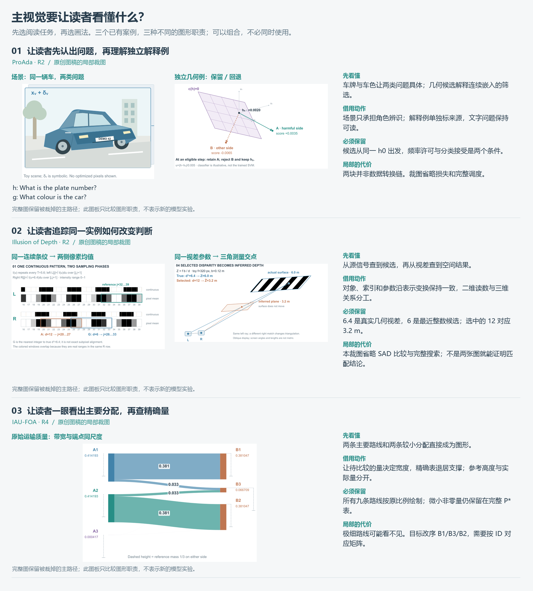
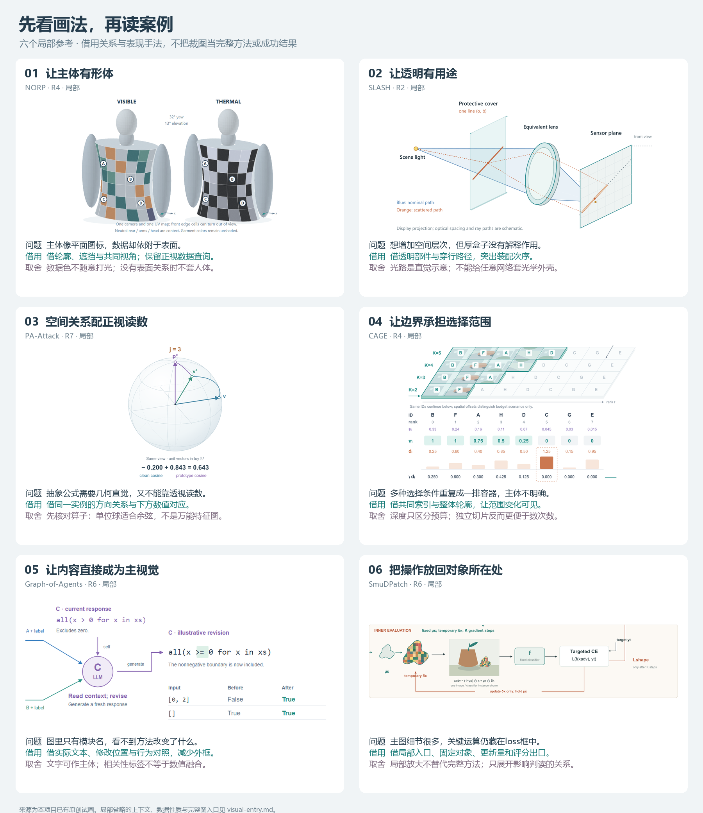
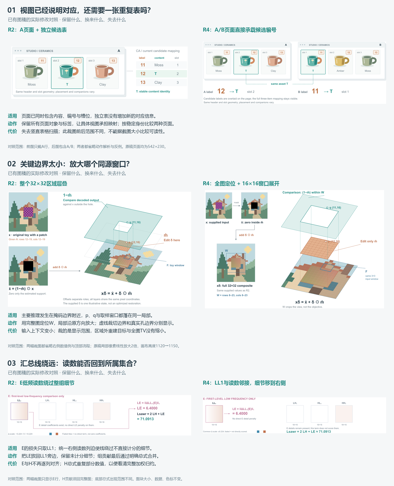

# 按视觉问题选参考

这是对现有参考库的视觉入口，不是新增方法分类。先按当前缺口看一个局部，再读对应案例与完整图；没有匹配项就直接按论文对象设计，不必从六项中硬选。所有截图来自本项目原创试画，均非作者实验结果。

参考中的关系可借用，整图尺寸与文字密度需重新设计。先按[图形主导与论文版面](visual-first-layout.md)确定占位，不能照搬大屏示意图或把历史评分当作论文适配证据。

已有图稿要改布局时，先看[三组修改对照](#已有图稿比较修改的收益与代价)，不用遍历全部图例。

<!-- visual-roles:start -->
## 先选主视觉的解释任务

| 想让读者看懂 | 借用动作 | 具体例与取舍 |
|---|---|---|
| 对象与问题为何相关 | 用具体内容建立角色；独立解释例单独命名 | [ProAda R2](cases/proada.md)：车牌/车色说明两类问题，嵌入筛选由独立线性例解释，二者不是数据转换链 |
| 同一输入怎样决定后续结果 | 同一对象贯穿采样、判据和空间解释 | [Illusion of Depth R2](cases/illusion-depth.md)：同一信号得到像素与匹配代价，视差接几何；裁图省略SAD，必须回完整图追判据 |
| 数量如何分配、哪里不同 | 量决定图形宽度/位置，精确读数辅助 | [IAU-FOA R4](cases/iau-foa.md)：真实质量流带；小量可能不可见，完整表保留，目标改序需要按ID对应 |

> 先补全“读者通过____看懂____”。据此决定场景、运算或数量关系谁占主位；给其余内容分配支撑职责。参考与新论文只需在解释任务上匹配，不要求对象、布局或三维比例相同。独立算例不能冒充模型输出；同源计算也不等于真实实验。

这是对已有图稿的回看整理。与下方六种画法配合选用，无须逐项使用；本图板未经过新的前向生成或用户阅读测试。
<!-- visual-roles:end -->

视觉对抗机制可进一步看[候选、反馈与共享权重图板](adversarial-entry.md)。三张已有局部对应不同的操作关系；仅研究主题相同，不足以套用相同构图。

## 从局部回到完整方法

| 局部 | 适合处理 | 完整案例与边界 |
|---|---|---|
| 01 · 让主体有形体 | 主体像平面图标，数据却依附于表面。 | [NORP · R4](cases/norp.md)。此裁图只显示双模态曲面；完整NORP还含材料、UV、训练状态与发布。人体为解析示意，非论文网格或实测热像。 |
| 02 · 让透明有用途 | 想增加空间层次，但厚盒子没有解释作用。 | [SLASH · R2](cases/slash.md)。这里只显示光学装配；同稿右侧才计算投影与衰减。部件距离和光路不来自物理追迹，裁图不能当完整光学模型。 |
| 03 · 空间关系配正视读数 | 抽象公式需要几何直觉，又不能靠透视读数。 | [PA-Attack · R7](cases/pa-attack.md)。只裁一个token的局部解释。向量是新构造的三维小例，不是鸟图嵌入或PCA；完整图还保留权重及两项小计，完整方法另附。 |
| 04 · 让边界承担选择范围 | 多种选择条件重复成一排容器，主体不明确。 | [CAGE · R4](cases/cage.md)。裁图省略概率公式、RDA分支和优化回路。八token及四个等概率预算均为示意；非均匀先验不能只数次数。 |
| 05 · 让内容直接成为主视觉 | 图里只有模块名，看不到方法改变了什么。 | [Graph-of-Agents · R6](cases/goa.md)。此裁图省略左侧peer全文和底部用户消息结构。代码更新是说明性例子，不是实测LLM输出；完整图才能看输入范围。 |
| 06 · 把操作放回对象所在处 | 主图细节很多，关键运算仍藏在loss框中。 | [SmuDPatch · R6](cases/smudpatch.md)。只裁候选的临时纹理评价；完整图另有进化搜索和最终纹理训练。这里仅示一个图像/分类器实例，没有优化结果或fitness值。 |

## 借用时写一句决定

> 我借用____的____，用于解释本论文的____；保留____作为正视读数；因为____，不沿用参考里的____。

这句话用来让选择具体，不是额外必填表。典型误用：给文本关系套人体，给网络层套镜头，以单位球解释非归一化点积，或者只保留漂亮局部而丢掉方法出口。不同表示能组合，但主体、操作和读数应来自同一机制。

更细的关系选型和各版本取舍见[构图指南](design-guide.md)，来源观察见[原论文图谱](reference-atlas.md)。局部裁图仅帮助选择表示；确定方案后仍需看完整图及图注。

## 没有匹配项时

这里不是六选一。AD²的相机×时间索引，应转构图指南“看分组”；FlashInfer的逻辑页映射应转“查对应”；Anti-I2V的色空间局部虽可借“空间配读数”，几何必须是其实际Lab平面，不能照搬单位球。以上是基于既有案例的人工选择推演，尚未进行新图生成测试。

CAGE局部由同坐标的上下两段裁图组成，省去右侧无关公式卡，没有移动其单元或数值。其他局部均为矩形裁图。

## 实际试用：TARA

用 2026-10-11 的新论文 [TARA](cases/tara.md) 实际试画：组合“表面承载数据”和“操作接回对象”，把两个视频轨迹作为主体、特征关系及权重放回二维。几何与遮挡生成同一支持面积，更新回路保留重新渲染。入口帮助明确了借用动作，但单次生成没有证明质量提升；完整图仍有长回线与小纹理的局限。不能把此前人工选型推演和这次出图当作用户审美认可。

<!-- design-decisions:start -->
## 已有图稿：比较修改的收益与代价

| 当前阅读成本 | 可借用的修改 | 先确认与取舍 |
|---|---|---|
| 重复对应：对象图与独立表在说同一件事 | [WebMirage R2→R4](cases/webmirage.md)：页面直接承载当前编号 | 对应信息已完整可读才可省表；失去竖直表扫描。裁图前后范围不同 |
| 局部太小：关键边界、取样点不易辨认 | [MROP R2→R4](cases/mrop.md)：全图定位、同源窗口放大 | 显示范围与运算范围分开；上下文缩小、完整比较域不再全部展开 |
| 汇总绕远：读数与所属集合分离 | [SAWR R2→R4](cases/sawr.md)：组旁贡献、总式合并 | 组内选择和权重仍完整；E/H不再逐列对齐，数值略有重复 |

> 先定位读者在哪一步需要多查一次，再只改变造成该成本的组织。借用前写清保留的对象/数据、变大的局部、缩小或省略的上下文；按同一关系看修改后的得失。没有匹配问题就按论文内容另选，不逐项套用。

图板只显示裁取范围，均等比适配；不能据截图尺寸断言阅读更快。原稿数据与完整方法见各案例。它整理已有修改，没有新增前向生成或用户审美测试。
<!-- design-decisions:end -->
